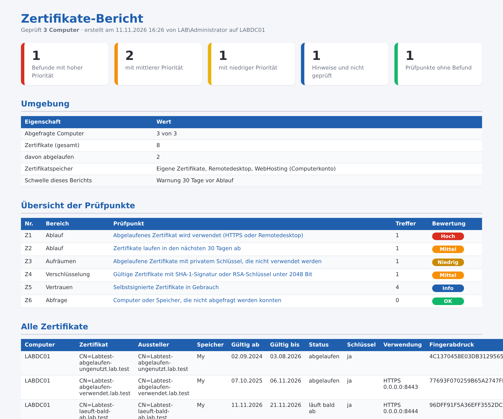

# Zertifikate-Bericht – abgelaufene und bald ablaufende Zertifikate auf Windows-Servern finden

Kostenloses PowerShell-Skript: liest die Zertifikate auf Windows-Servern aus und meldet, **welche abgelaufen sind, bald ablaufen oder schwach sind – und welche davon ein Dienst tatsächlich verwendet** (HTTPS oder Remotedesktop). Ergebnis ist ein übersichtlicher **HTML-Bericht auf Deutsch**. Das Skript arbeitet **ausschließlich lesend**: Es installiert, löscht oder erneuert keine Zertifikate, ändert keine Bindungen und überträgt keine Daten. Private Schlüssel werden nicht gelesen, nur ob einer vorhanden ist.



Der gezeigte Bericht stammt aus einer Testumgebung. Das vollständige Beispiel liegt als [Beispielbericht.html](Beispielbericht.html) bei.

## Was geprüft wird

| Nr. | Bereich | Prüfpunkt |
|---|---|---|
| Z1 | Ablauf | Abgelaufenes Zertifikat wird verwendet (HTTPS oder Remotedesktop) |
| Z2 | Ablauf | Zertifikate laufen in den nächsten 30 Tagen ab (einstellbar) |
| Z3 | Aufräumen | Abgelaufene Zertifikate mit privatem Schlüssel, die nicht verwendet werden |
| Z4 | Verschlüsselung | Gültige Zertifikate mit SHA-1-/MD5-Signatur oder RSA-Schlüssel unter 2048 Bit |
| Z5 | Vertrauen | Selbstsignierte Zertifikate in Gebrauch |
| Z6 | Abfrage | Computer, die nicht abgefragt werden konnten (stehen als „nicht geprüft“ im Bericht, außerdem als Zeile „Nicht geprüft“ in Z1 bis Z5) |

Jeder Befund kommt mit Erklärung und Empfehlung. Dazu gibt es eine Liste aller Zertifikate mit Gültigkeit, Verwendung und Fingerabdruck.

## Start

Den lokalen Computer prüfen:

```powershell
powershell -ExecutionPolicy Bypass -File .\Zertifikate-Bericht.ps1
```

Weitere Computer über die PowerShell-Fernverwaltung (WinRM) abfragen, oder alle aktiven Server aus dem Active Directory:

```powershell
.\Zertifikate-Bericht.ps1 -Computer srv01, srv02
.\Zertifikate-Bericht.ps1 -AusAD -WarnTage 60 -Csv -Ausgabe C:\Berichte\zertifikate.html
```

Optionen: `-WarnTage <Zahl>` (Standard 30), `-Csv`, `-Ausgabe <Pfad>`, `-OhneLokalen`, `-Anmeldung (Get-Credential)`, `-Server <DC>` (mit `-AusAD`), `-NichtOeffnen`, `-PassThru`. Alle Optionen zeigt `Get-Help .\Zertifikate-Bericht.ps1 -Detailed`. Ohne `-Ausgabe` landet der Bericht im aktuellen Ordner; bei mehreren Computern heißt er `Zertifikate-Bericht_<n>-Computer_<Datum>.html`. CSV-Dateien sind mit Semikolon getrennt und UTF-8 mit BOM.

**Voraussetzungen:** Windows PowerShell 5.1. Für die Fernabfrage ein Konto, das auf den Zielcomputern lokaler Administrator oder „Remoteverwaltungsbenutzer“ ist, und erreichbares WinRM. Das Skript ändert keine WinRM- oder Firewall-Einstellungen. Für `-AusAD` das Modul `ActiveDirectory`.

## Was das Skript sieht und was nicht

- Gelesen werden die Speicher „Eigene Zertifikate“, „Remotedesktop“ und „WebHosting“ des Computerkontos.
- „In Gebrauch“ heißt: Das Zertifikat ist einer HTTPS-Bindung von HTTP.sys (an IP und Port oder an einen Hostnamen mit SNI; z. B. IIS, Exchange-Webdienste, WinRM über HTTPS) oder Remotedesktop zugeordnet. Remotedesktop zählt nur, wenn das Zertifikat ausdrücklich festgelegt ist (Gruppenrichtlinie oder Einstellung), nicht beim automatisch erzeugten Zertifikat. Der zentrale Zertifikatspeicher (CCS) von IIS wird nicht ausgewertet; ist er in Gebrauch, meldet das der Bericht als „nicht geprüft“. Ein Zertifikat, das in mehreren Speichern liegt, erscheint mehrfach. Dienste, die ihr Zertifikat anderswo ablegen (SMTP, IMAP und POP von Exchange, LDAPS, eigene Speicher), erscheinen in der Liste, aber ohne diesen Vermerk.
- Getestet mit Windows Server 2025 (deutsch) in zwei voneinander unabhängigen Testumgebungen: abgelaufene, bald ablaufende, SHA-1- und kurze Zertifikate in HTTPS-Bindungen (auch SNI), lokal, per `-Computer` und per `-AusAD`, nicht erreichbare Computer. Nicht getestet: ältere Windows-Versionen, sehr große Umgebungen.

## Weitere Prüfskripte

Für Active Directory, Domänencontroller, Dateiserver und Exchange gibt es weitere Skripte im Shop, alle nur lesend und mit HTML-Bericht:

➜ **[IT Admin Tools by MM auf Etsy](https://www.etsy.com/shop/ITAdminToolsbyMM)** · **[auf Gumroad](https://mueller86.gumroad.com)**

Kostenlos auf GitHub:

- [AD-Schnellcheck](https://github.com/jackyno7/ad-schnellcheck) (8 Prüfpunkte zur Domäne)
- [Privilegierte-Konten-Check](https://github.com/jackyno7/privilegierte-konten-check) (7 Prüfpunkte zu Administratorkonten)

## Hinweise

- Der Bericht enthält Computernamen, Zertifikatsnamen und Fingerabdrücke – bitte vertraulich behandeln.
- Der Bericht zeigt Auffälligkeiten anhand fester Regeln. Er ersetzt keine Zertifikatsverwaltung und erhebt keinen Anspruch auf Vollständigkeit.
- Nutzung auf eigene Verantwortung, siehe [LICENSE](LICENSE).
- Bei der Ausarbeitung wurden KI-Werkzeuge unterstützend eingesetzt; Inhalte und Skript wurden fachlich geprüft und im Testlab getestet.

---

### English

Free, read-only PowerShell script that reads certificates on Windows servers and reports expired, soon-to-expire and weak certificates, and which of them a service actually uses (HTTPS bindings, Remote Desktop). German HTML report with findings and recommendations. Nothing is changed and no data is sent anywhere (with remote queries the certificate data travels from the target computer to the computer running the script). Run: `powershell -ExecutionPolicy Bypass -File .\Zertifikate-Bericht.ps1`.
